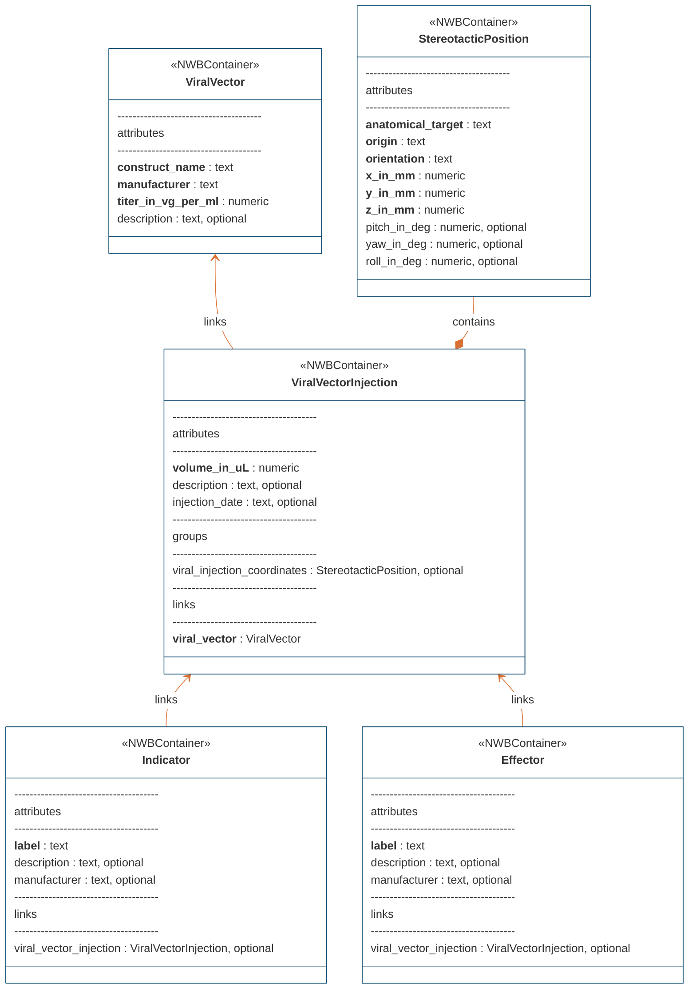
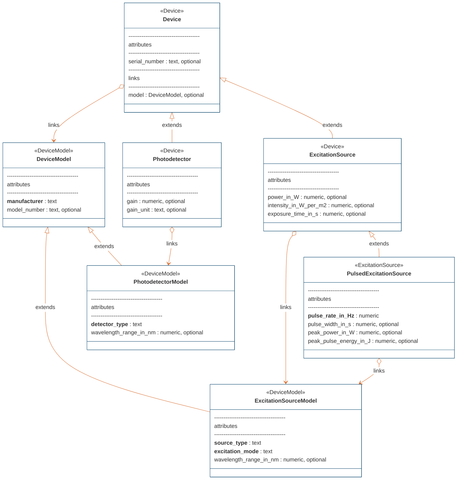
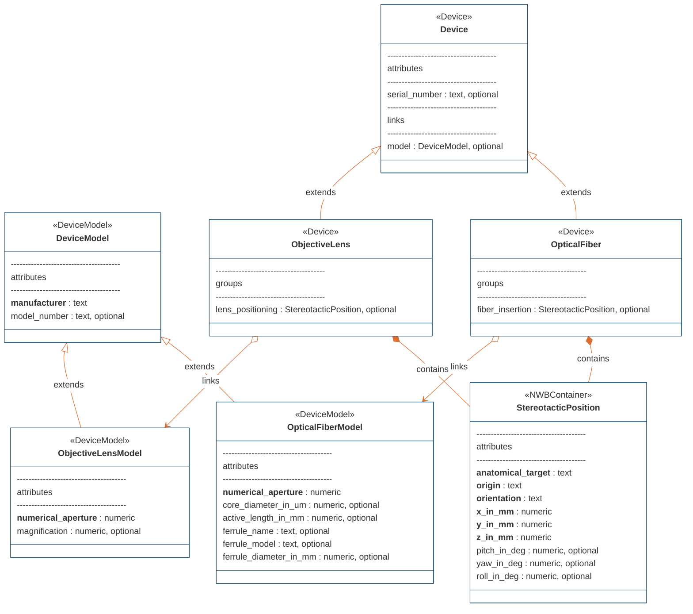
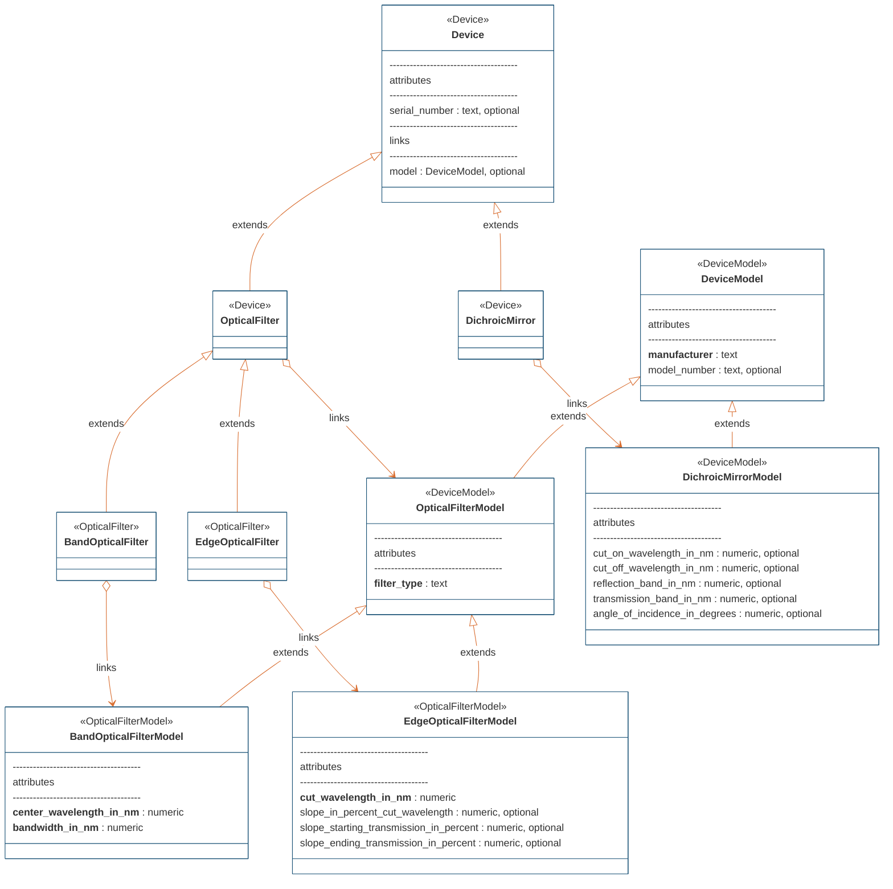

# ndx-ophys-devices Extension for NWB

This is an NWB extension for storing metadata of devices used in optical experimental setup (microscopy, fiber photometry, optogenetic stimulation etc.)

This extension consists of neurodata types in the following categories:

**Container Classes:**

- **ViralVector** extends NWBContainer to hold metadata on viral vectors used for gene delivery.
- **ViralVectorInjection** extends NWBContainer to hold metadata on viral vector injection procedures.
- **Indicator** extends NWBContainer to hold metadata on the fluorescent indicator.
- **Effector** extends NWBContainer to hold metadata on the effector/opsin.
- **StereotacticPosition** extends NWBContainer to hold metadata about the stereotactic position of a device relative to the brain.

**Model Classes:**

- **OpticalFiberModel** extends DeviceModel to hold metadata on the optical fiber model.
- **ExcitationSourceModel** extends DeviceModel to hold metadata on the excitation source model.
- **PhotodetectorModel** extends DeviceModel to hold metadata on the photodetector model.
- **DichroicMirrorModel** extends DeviceModel to hold metadata on the dichroic mirror model.
- **OpticalFilterModel** extends DeviceModel to hold metadata on a general optical filter model.
- **BandOpticalFilterModel** extends OpticalFilterModel to hold metadata on any bandpass or bandstop optical filter models.
- **EdgeOpticalFilterModel** extends OpticalFilterModel to hold metadata on any edge optical filter models.
- **ObjectiveLensModel** extends DeviceModel to hold metadata on the objective lens model.

**Device Classes:**

- **OpticalFiber** extends Device to hold metadata on optical fibers.
- **ExcitationSource** extends Device to hold metadata on excitation sources.
- **PulsedExcitationSource** extends ExcitationSource to hold metadata on pulsed excitation sources.
- **Photodetector** extends Device to hold metadata on photodetectors.
- **DichroicMirror** extends Device to hold metadata on dichroic mirrors.
- **OpticalFilter** extends Device to hold metadata on general optical filters.
- **BandOpticalFilter** extends OpticalFilter to hold metadata on bandpass or bandstop optical filters.
- **EdgeOpticalFilter** extends OpticalFilter to hold metadata on edge optical filters.
- **ObjectiveLens** extends Device to hold metadata on objective lenses.

Note that the container classes cannot be added to the NWB file directly. They are stored in a `LabMetaData` provided by
the extension for your experiment:
[ndx-microscopy](https://github.com/catalystneuro/ndx-microscopy) (`MicroscopyExperimentMetadata`),
[ndx-fiber-photometry](https://github.com/catalystneuro/ndx-fiber-photometry) (`FiberPhotometry`) or
[ndx-optogenetics](https://github.com/rly/ndx-optogenetics) (`OptogeneticExperimentMetadata`).

## Installation
To install the latest stable release through PyPI,
```bash
pip install ndx-ophys-devices
```

## Usage

```python
import datetime

from pynwb import NWBFile

from ndx_ophys_devices import (
    # Container classes
    ViralVector,
    ViralVectorInjection,
    Indicator,
    Effector,
    StereotacticPosition,
    # Model classes
    OpticalFiberModel,
    ExcitationSourceModel,
    PhotodetectorModel,
    DichroicMirrorModel,
    BandOpticalFilterModel,
    EdgeOpticalFilterModel,
    ObjectiveLensModel,
    # Device classes
    OpticalFiber,
    ExcitationSource,
    PulsedExcitationSource,
    Photodetector,
    DichroicMirror,
    BandOpticalFilter,
    EdgeOpticalFilter,
    ObjectiveLens,
)

nwbfile = NWBFile(
    session_description="session_description",
    identifier="identifier",
    session_start_time=datetime.datetime.now(datetime.timezone.utc),
)

# Molecular tools: a dopamine sensor injected in the nucleus accumbens (NAc) core
# and an opsin injected in the ventral tegmental area (VTA)
indicator_vector = ViralVector(
    name="indicator_vector",
    description="AAV for dLight1.3b expression in NAc neurons",
    construct_name="AAV5-CAG-dLight1.3b",
    manufacturer="Addgene",
    titer_in_vg_per_ml=5.0e12,
)
indicator_injection = ViralVectorInjection(
    name="indicator_injection",
    description="Unilateral injection in the right NAc core, 3 weeks before recording",
    volume_in_uL=0.5,
    injection_date="2025-01-15",
    viral_injection_coordinates=StereotacticPosition(
        name="viral_injection_coordinates",  # this name is required
        anatomical_target="Nucleus accumbens core",
        origin="bregma (AP, ML); skull surface (DV)",
        orientation="RAS",
        x_in_mm=1.3,  # 1.3 mm right of the midline
        y_in_mm=1.3,  # 1.3 mm anterior to bregma
        z_in_mm=-4.5,  # 4.5 mm ventral
    ),
    viral_vector=indicator_vector,
)
indicator = Indicator(
    name="indicator",
    description="Genetically encoded dopamine sensor",
    label="dLight1.3b",
    viral_vector_injection=indicator_injection,
)

effector_vector = ViralVector(
    name="effector_vector",
    description="AAV for Cre-dependent ChrimsonR expression in dopaminergic neurons",
    construct_name="AAV5-Syn-FLEX-ChrimsonR-tdTomato",
    manufacturer="Addgene",
    titer_in_vg_per_ml=4.0e12,
)
effector_injection = ViralVectorInjection(
    name="effector_injection",
    description="Unilateral injection in the right VTA of a DAT-Cre mouse",
    volume_in_uL=0.3,
    injection_date="2025-01-15",
    viral_injection_coordinates=StereotacticPosition(
        name="viral_injection_coordinates",
        anatomical_target="Ventral tegmental area",
        origin="bregma (AP, ML); skull surface (DV)",
        orientation="RAS",
        x_in_mm=0.5,
        y_in_mm=-3.2,  # posterior targets are negative in RAS
        z_in_mm=-4.4,
    ),
    viral_vector=effector_vector,
)
effector = Effector(
    name="effector",
    description="Red-shifted excitatory opsin",
    label="ChrimsonR",
    viral_vector_injection=effector_injection,
)

# Device models (catalog specifications)
optical_fiber_model = OpticalFiberModel(
    name="optical_fiber_model",
    manufacturer="Doric Lenses",
    model_number="MFC_400/430-0.48_5mm_MF2.5_FLT",
    description="Flat-cleaved 400 um fiber optic cannula for photometry",
    numerical_aperture=0.48,
    core_diameter_in_um=400.0,
    ferrule_name="Metal ferrule 2.5 mm",
    ferrule_diameter_in_mm=2.5,
)
excitation_source_model = ExcitationSourceModel(
    name="excitation_source_model",
    manufacturer="Doric Lenses",
    model_number="CLED_465",
    description="Connectorized 465 nm LED",
    source_type="LED",
    excitation_mode="one-photon",
    wavelength_range_in_nm=[450.0, 480.0],
)
laser_model = ExcitationSourceModel(
    name="laser_model",
    manufacturer="Coherent",
    model_number="Chameleon Ultra II",
    description="Tunable Ti:Sapphire femtosecond laser",
    source_type="Solid-State Laser",
    excitation_mode="two-photon",
    wavelength_range_in_nm=[680.0, 1080.0],
)
photodetector_model = PhotodetectorModel(
    name="photodetector_model",
    manufacturer="Newport",
    model_number="2151",
    description="Femtowatt silicon photoreceiver",
    detector_type="Photodiode",
    wavelength_range_in_nm=[300.0, 1050.0],
)
dichroic_mirror_model = DichroicMirrorModel(
    name="dichroic_mirror_model",
    manufacturer="Semrock",
    model_number="FF495-Di03",
    description="495 nm longpass dichroic separating blue excitation from green emission",
    cut_on_wavelength_in_nm=495.0,
    reflection_band_in_nm=[350.0, 484.0],
    transmission_band_in_nm=[506.0, 800.0],
    angle_of_incidence_in_degrees=45.0,
)
band_optical_filter_model = BandOpticalFilterModel(
    name="band_optical_filter_model",
    manufacturer="Semrock",
    model_number="FF03-525/50",
    description="525/50 nm bandpass emission filter for green fluorescence",
    filter_type="Bandpass",
    center_wavelength_in_nm=525.0,
    bandwidth_in_nm=50.0,  # 525 +/- 25 nm
)
edge_optical_filter_model = EdgeOpticalFilterModel(
    name="edge_optical_filter_model",
    manufacturer="Semrock",
    model_number="FF01-492/SP",
    description="492 nm shortpass excitation cleanup filter",
    filter_type="Shortpass",
    cut_wavelength_in_nm=492.0,
)
objective_lens_model = ObjectiveLensModel(
    name="objective_lens_model",
    manufacturer="Olympus",
    model_number="XLPLN25XWMP2",
    description="25x water-immersion objective for two-photon imaging",
    numerical_aperture=1.05,
    magnification=25.0,
)
for device_model in (
    optical_fiber_model,
    excitation_source_model,
    laser_model,
    photodetector_model,
    dichroic_mirror_model,
    band_optical_filter_model,
    edge_optical_filter_model,
    objective_lens_model,
):
    nwbfile.add_device_model(device_model)

# Devices (the physical units used in this session)
optical_fiber = OpticalFiber(
    name="optical_fiber",
    description="Fiber implanted 0.2 mm above the injection site",
    serial_number="OF-SN-123456",
    model=optical_fiber_model,
    fiber_insertion=StereotacticPosition(
        name="fiber_insertion",  # this name is required
        anatomical_target="Nucleus accumbens core",
        origin="bregma (AP, ML); skull surface (DV)",
        orientation="RAS",
        x_in_mm=1.3,
        y_in_mm=1.3,
        z_in_mm=-4.3,  # position of the fiber tip
        pitch_in_deg=0.0,
        yaw_in_deg=0.0,
        roll_in_deg=0.0,  # vertical implant
    ),
)
excitation_source = ExcitationSource(
    name="excitation_source",
    description="465 nm LED for dLight excitation",
    serial_number="ES-SN-123456",
    model=excitation_source_model,
    power_in_W=30e-6,  # 30 uW at the fiber tip
)
pulsed_excitation_source = PulsedExcitationSource(
    name="pulsed_excitation_source",
    description="Ti:Sapphire laser tuned to 920 nm",
    serial_number="PES-SN-123456",
    model=laser_model,
    power_in_W=0.05,  # 50 mW average power at the sample
    pulse_rate_in_Hz=80e6,  # laser repetition rate
    pulse_width_in_s=140e-15,
    peak_pulse_energy_in_J=6.25e-10,  # 0.05 W / 80 MHz
    peak_power_in_W=4.5e3,  # 6.25e-10 J / 140 fs
)
photodetector = Photodetector(
    name="photodetector",
    description="Photoreceiver for green emission",
    serial_number="PD-SN-123456",
    model=photodetector_model,
    gain=1.0e10,  # gain setting used in this session
    gain_unit="V/W",
)
dichroic_mirror = DichroicMirror(
    name="dichroic_mirror",
    description="Dichroic mirror in the photometry filter cube",
    serial_number="DM-SN-123456",
    model=dichroic_mirror_model,
)
emission_filter = BandOpticalFilter(
    name="emission_filter",
    description="Emission filter in the photometry filter cube",
    serial_number="BOF-SN-123456",
    model=band_optical_filter_model,
)
excitation_filter = EdgeOpticalFilter(
    name="excitation_filter",
    description="Excitation filter in the photometry filter cube",
    serial_number="EOF-SN-123456",
    model=edge_optical_filter_model,
)
objective_lens = ObjectiveLens(
    name="objective_lens",
    description="Objective above a cranial window; not implanted, so no lens_positioning",
    serial_number="OL-SN-123456",
    model=objective_lens_model,
)
for device in (
    optical_fiber,
    excitation_source,
    pulsed_excitation_source,
    photodetector,
    dichroic_mirror,
    emission_filter,
    excitation_filter,
    objective_lens,
):
    nwbfile.add_device(device)

# ViralVector, ViralVectorInjection, Indicator and Effector are stored in the LabMetaData
# of the experiment extension you use, e.g. ndx-microscopy, ndx-fiber-photometry or ndx-optogenetics.
```

## Stereotactic positions

`StereotacticPosition` is used in three places, each with a fixed name that must be passed as `name`:

| Parent | Field and required `name` | Quantity |
|---|---|---|
| `OpticalFiber` | `fiber_insertion` | optional (omit for patch cords) |
| `ObjectiveLens` | `lens_positioning` | optional (use for implanted lenses, e.g. GRIN) |
| `ViralVectorInjection` | `viral_injection_coordinates` | optional |

Conventions:

- `x_in_mm`, `y_in_mm` and `z_in_mm` give the target: the tip of an implanted fiber or lens, or the injection site.
- `origin` says where (0, 0, 0) is. If the dorsal-ventral value is measured from a different reference than the other two,
  say so, e.g. `"bregma (AP, ML); skull surface (DV)"`.
- `orientation` gives the direction of each axis. With `"RAS"`, x is right, y is anterior and z is dorsal, so posterior
  and ventral targets are negative.
- All angles equal to 0 mean a vertical approach. `pitch_in_deg` tilts the approach in the y-z plane and `roll_in_deg` in
  the x-z plane; a positive value means the target lies toward +y or +x from the entry point. `yaw_in_deg` is the rotation
  of the device around its own axis, relevant for angled-tip fibers or prisms. For example, a fiber implanted with a
  10 degree mediolateral angle from the left side, so that its tip lies to the right of the entry point, has
  `roll_in_deg=10.0`.

## Entity relationship diagrams

In the diagrams, names in `**bold**` are required.

#### Molecular Tools



#### Photodetector and ExcitationSource



#### Optical Fiber and Objective Lens


#### Optical Filters and Dichroic Mirrors



## Contributing

To help ensure a smooth Pull Request (PR) process, please always begin by raising an issue on the main repository so we can openly discuss any problems/additions before taking action.

The main branch of ndx-ophys-devices is protected; you cannot push to it directly. You must upload your changes by pushing a new branch, then submit your changes to the main branch via a Pull Request. This allows us to conduct automated testing of your contribution, and gives us a space for developers to discuss the contribution and request changes. If you decide to tackle an issue, please make yourself an assignee on the issue to communicate this to the team. Don’t worry - this does not commit you to solving this issue. It just lets others know who they should talk to about it.

From your local copy directory, use the following commands.

If you have not already, you will need to clone the repo:
```bash
$ git clone https://github.com/catalystneuro/ndx-ophys-devices
```

First create a new branch to work on
```bash
$ git checkout -b <new_branch>
```

Make your changes. Add new devices related to optical experiment setup or add more attributes on the existing ones. To speed up the process, you can write mock function (see _mock.py) that would be used to test the new neurodata type

We will automatically run tests to ensure that your contributions didn’t break anything and that they follow our style guide. You can speed up the testing cycle by running these tests locally on your own computer by calling pytest from the top-level directory.
Push your feature branch to origin (i.e. GitHub)

```bash
$ git push origin <new_branch>
```

Once you have tested and finalized your changes, create a pull request (PR) targeting main as the base branch:
Ensure the PR description clearly describes the problem and solution.
Include the relevant issue number if applicable. TIP: Writing e.g. “fix #613” will automatically close issue #613 when this PR is merged.
Before submitting, please ensure that the code follows the standard coding style of the respective repository.
If you would like help with your contribution, or would like to communicate contributions that are not ready to merge, submit a PR where the title begins with “[WIP].”

Update the CHANGELOG.md regularly to document changes to the extension.

NOTE: Contributed branches will be removed by the development team after the merge is complete and should, hence, not be used after the pull request is complete.


---
This extension was created using [ndx-template](https://github.com/nwb-extensions/ndx-template).
